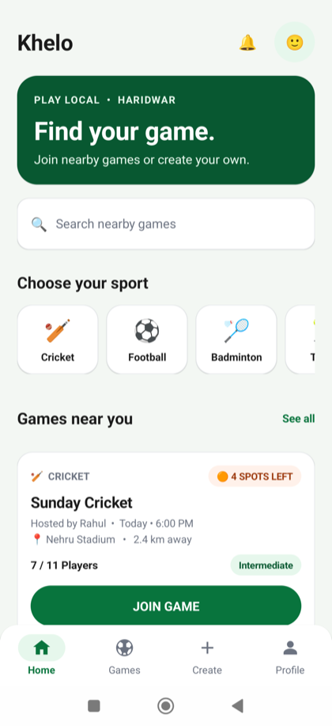
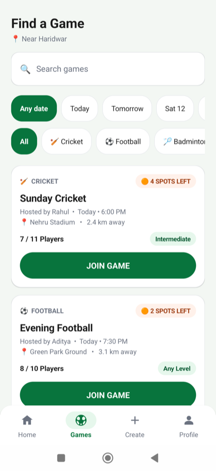
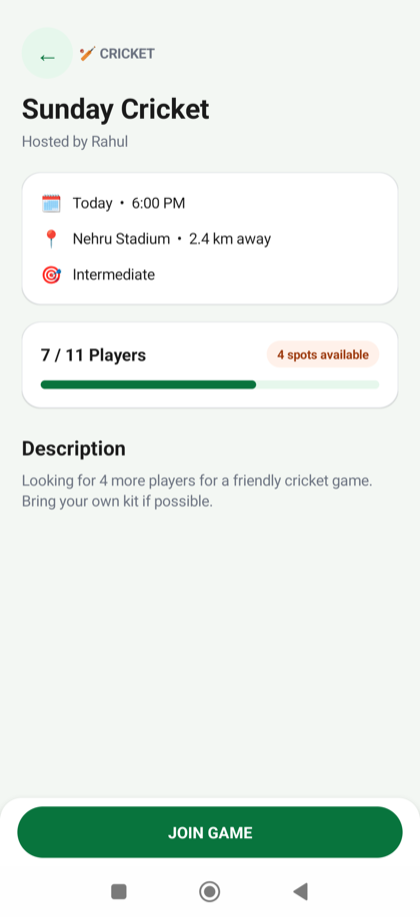
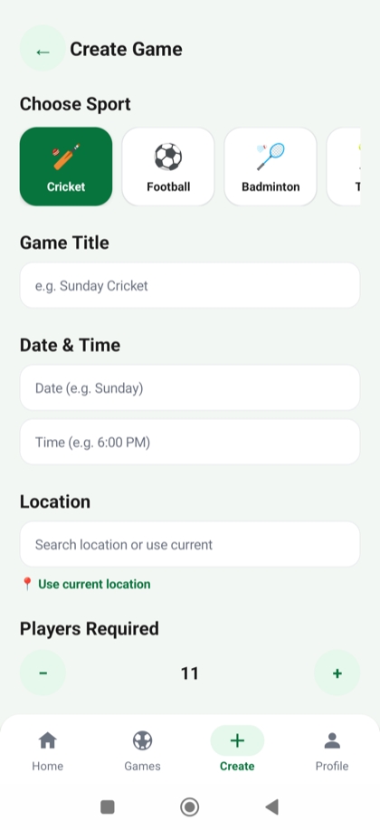
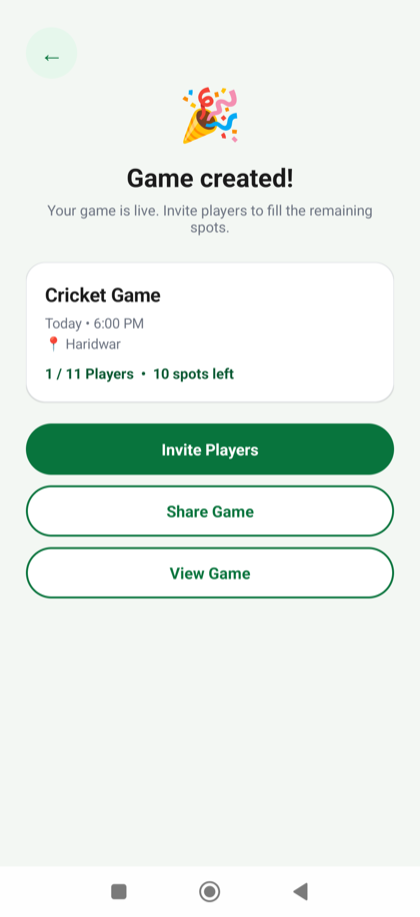
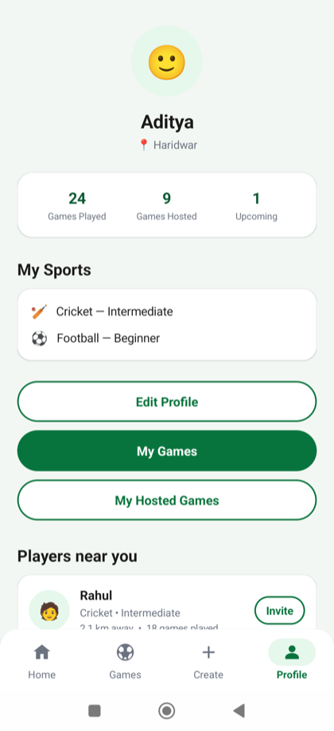
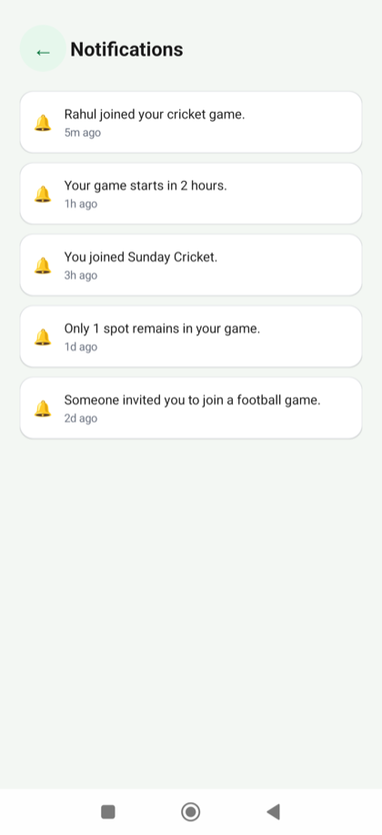

# Khelo

Find a nearby game, see who has room for another player, or organize a match of your own. Khelo is a native Android prototype for recreational sports.


## About Khelo

Khelo brings game discovery and hosting into the same app. Start with a sport or search nearby listings, check the venue, time, skill level, and open spots, then join a game or create a listing. The prototype uses bundled sample data. It starts on Home and requires no account, onboarding, or backend setup.

## Features

- Browse games by sport and date, or search by title, venue, host, or sport.
- Open a game to see its details and capacity. Join or leave a game to update its local player count.
- Create a game with a sport, title, date, time, venue, player limit, skill level, and optional notes.
- Keep a Create draft when switching tabs or recreating the activity.
- View a sample profile, nearby players, and a sample notifications feed.

## Application screenshots

Captured from the running Android app on a connected Xiaomi phone in three-button navigation mode. The gallery uses bundled demo data and trims the phone's status bar.

| Home | Games | Game details |
| --- | --- | --- |
|  |  |  |
| Search nearby listings, open a sport filter, or reach Notifications and Profile. | Combine search, date, and sport filters, then tap a card to see more. | Review time, venue, skill level, and open spots before joining. Back restores the previous screen. |

| Create game | Game created |
| --- | --- |
|  |  |
| Choose a sport and fill out the match form. Scroll for player count, skill level, notes, and the submit action. | Review the new listing and use **View Game** to open its details. Invite and share buttons show prototype feedback. |

| Profile | Notifications |
| --- | --- |
|  |  |
| View the demo player's sports and local game counts. Scroll to see nearby players. | Read the bundled activity feed from the bell on Home, then use Back to return. |

## Tech stack

| Area | Implementation |
| --- | --- |
| Language and UI | Kotlin, programmatic Android Views, AndroidX AppCompat, AndroidX Core, Material Components with a Material 3 light theme |
| Build | Gradle 9.3.1 wrapper, Android Gradle Plugin 9.1.1, Gradle daemon JDK 21 |
| Android SDK | Compile 36.1, target 36, minimum 24 |
| Testing | JUnit 4, AndroidX Test, Espresso dependency |

## Project structure

```text
Khelo/
├── app/
│   └── src/
│       ├── main/
│       │   ├── AndroidManifest.xml
│       │   ├── java/com/example/khelo/  # Activity, screens, UI kit, navigation, models, demo data
│       │   └── res/                   # Theme, icons, and launcher assets
│       ├── test/                      # JVM tests
│       └── androidTest/                # On-device regression tests
├── docs/screenshots/                  # Captures from the running app
├── gradle/                            # Wrapper, JVM criteria, and version catalog
└── KHELO_UI_AUDIT.md                    # Navigation and layout audit
```

## Installation and setup

1. Install Android Studio with support for AGP 9.1.1. In SDK Manager, install Android SDK Platform 36.1 and Android SDK Platform-Tools. Use JDK 21 for the Gradle daemon.
2. Clone the private repository using a GitHub account with access:

   ```sh
   git clone https://github.com/Aditya-xcity/Khelo.git
   cd Khelo
   ```

3. Open the project root in Android Studio and sync Gradle. Studio creates the machine-specific `local.properties` with the SDK location. No API credentials or environment files are required.
4. Select an emulator running API 24 or newer, or connect an Android phone with USB debugging enabled and authorize the computer. Select the `app` run configuration and click **Run**.

To build and check the debug app from a terminal:

```sh
./gradlew assembleDebug testDebugUnitTest lintDebug
```

On Windows, use `gradlew.bat`. With a device or emulator connected, run `./gradlew connectedDebugAndroidTest` for the instrumented suite.

## Application navigation

**Home** is the entry point. The four primary tabs are Home, Games, Create, and Profile. Sport shortcuts on Home open Games with a sport selected. Game cards open details, and submitting the Create form opens a confirmation with a link to the new game's details. The bell on Home opens Notifications. Secondary screens hide the tab bar and use the same back stack as Android Back.

## Architecture

`MainActivity` owns the window, applies system and keyboard insets, and tracks routes and tabs. `Screens` constructs native views and calls the `KheloNav` interface for navigation and game actions. `UiKit` provides shared components and color tokens. A saved instance state bundle holds the current route, filters, scroll position, and Create draft.

`MockRepo` supplies sample sports, games, players, and notifications in memory. Game creation and membership changes are lost when the process ends. There is no authentication, backend, live location, push delivery, or persistent database. Some profile, location, invite, and share actions display simulated feedback.

## Future improvements

- Persist created games and membership across app restarts.
- Implement actual sharing and invites, editable profiles, and a live notifications source.
- Expand device testing for gesture navigation, landscape, font scaling, and accessibility.
